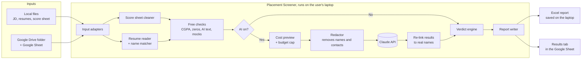

# Placement Screener

A privacy-first desktop tool that helps a college placement team decide which students to send to a company drive.

You give it **a job description, the students' score sheet and their resumes**. It checks the data for problems,
scores each student against the job, and writes a short remark and a few-hours improvement plan for every student.
The result is one report the team can act on.

> The tool gives recommendations only. A faculty member always makes the final decision.

**Status:** in development, built phase by phase (see [Roadmap](#roadmap)).

## Why this exists

Screening resumes by hand for one placement drive takes a full day, and the same problems keep coming up:

- CGPA on the resume doesn't match the official record
- Zero marks that mean pending backlogs
- Team projects claimed as solo work
- Text pasted from an AI chat and left in the resume
- Students with no mock interview attempts

Most of these can be caught by simple rules in seconds. AI is only needed for the part that needs judgement:
how well a student fits a specific job.

## How it works

### Step by step

1. **Read the inputs** from local files or from a Google Drive folder and Google Sheet.
2. **Clean the score sheet**: handle blanks, marks like `40*`, and zeros.
3. **Read the resumes** and match each one to a student by name.
4. **Run the free checks**: these never use AI and never leave the laptop.
5. **Optional AI review**: shows the cost first, removes personal details, then asks Claude to score each student
   against the job and write the remark and improvement plan.
6. **Decide the verdict in code** from the total score, so the same score always gets the same verdict.
   Any hard stop (like a CGPA mismatch) forces a Hold.
7. **Write the report** to Excel on the laptop, or back to a tab in the Google Sheet.

## Privacy

Privacy is the main design goal.

| Step | Where the data goes |
|---|---|
| Reading files, matching, free checks | Stays on the laptop |
| Excel report | Saved on the laptop only |
| Google Drive and Sheets | Directly between Google and the laptop |
| AI review (optional) | Only **redacted** resume text goes to the Claude API: no names, phone numbers, emails, links or addresses |

Other rules:

- An **AI off** switch runs only the local checks, so nothing leaves the laptop.
- Nothing is stored except the report you choose to save.
- API keys are kept in the operating system's password vault, never in plain files.
- Logs contain counts and errors only, never student data.
- This repository only contains **made-up sample data**. Real student data must never be committed.

More detail is in [docs/ARCHITECTURE.md](docs/ARCHITECTURE.md).

## Tech stack

| Part | Tool |
|---|---|
| Language | Python |
| Data cleaning | pandas |
| Reading resumes | pypdf |
| Excel report | openpyxl |
| App screens | Streamlit |
| Google input | gspread, Google Drive API |
| AI review | Claude API |
| Desktop app | PyInstaller, built by GitHub Actions |

## Roadmap

| Phase | What gets built | Status |
|---|---|---|
| 0 | Tools set up | Done |
| 1 | Repository, virtual environment, first commit | Done |
| 2 | Read and clean the score sheet | In progress |
| 3 | Read resumes and match them to students | |
| 4 | Free checks | |
| 5 | Excel report | |
| 6 | App screens (Streamlit) | |
| 7 | Google Drive and Sheets: read inputs, write results back | |
| 8 | Claude API: understand the job description | |
| 9 | Student reviews with redaction | |
| 10 | Cost preview, budget cap, AI on/off switch | |
| 11 | Tests and documentation | |
| 12 | Windows desktop app (.exe) | |

## Running it locally

Setup instructions will be added once the first working version is ready (Phase 6).

## Licence

MIT. See [LICENSE](LICENSE).
