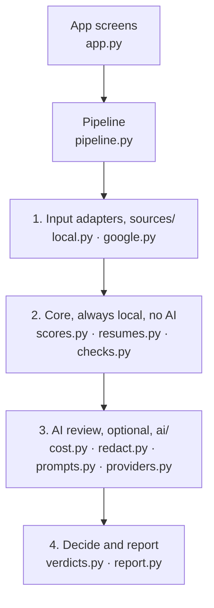
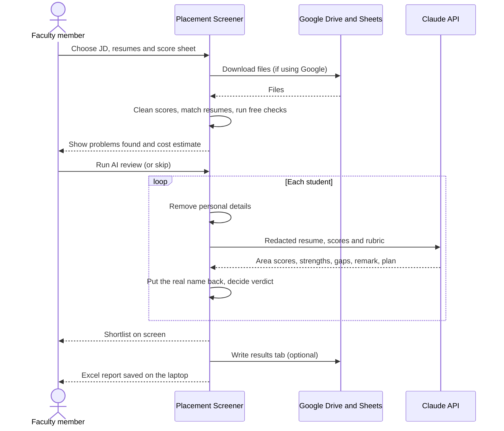

# Architecture

This document explains how Placement Screener is put together and why. It is written for anyone who wants to
understand, change or extend the tool.

## 1. Goals

1. **Privacy first.** Student data stays on the user's laptop wherever possible.
2. **Cheap to run.** Rules handle everything they can. AI is used only where judgement is needed, and the user
   sees the cost before any is spent.
3. **Consistent decisions.** The same scores always lead to the same verdict.
4. **Easy to extend.** New data sources (like Google Sheets) or AI providers can be added without rewriting the core.

## 2. Components



| Module | Job | Uses AI? | Data leaves laptop? |
|---|---|---|---|
| `sources/local.py` | Read files the user picks | No | No |
| `sources/google.py` | Read the Drive folder and Sheet, write results back | No | Only to and from the user's Google account |
| `scores.py` | Turn the score sheet into a clean table | No | No |
| `resumes.py` | Extract resume text, match each resume to a student | No | No |
| `checks.py` | CGPA mismatch, zero and low marks, duplicate CGPAs, missing education, leftover AI text, missing mocks | No | No |
| `ai/redact.py` | Replace names, phone numbers, emails, links and addresses with placeholders | No | No |
| `ai/providers.py` | Send redacted text to the AI and get structured scores back | Yes | Redacted text only |
| `ai/cost.py` | Estimate cost before a run and stop at the budget cap | No | No |
| `verdicts.py` | Add up area scores and decide the verdict | No | No |
| `report.py` | Write the Excel report or the results tab | No | Only to the user's Google Sheet, if chosen |

## 3. Data flow for one placement drive



## 4. Key decisions

**Inputs are cleaned into one table, whatever the source.** Every input adapter returns the same pandas table.
The rest of the tool never knows whether data came from a CSV file, an Excel file or a Google Sheet, so adding a
new source means writing one adapter.

**Rules before AI.** Checks that a formula can do (CGPA comparison, zero marks, duplicate CGPAs) are done in code.
They are free, instant and always give the same answer.

**Code decides the verdict, not the AI.** The AI scores each rubric area. Code clamps each score to its weight,
adds them up and maps the total to a verdict:

| Total score | Verdict |
|---|---|
| 75 and above | Send |
| 60 to 74 | Send after prep |
| 50 to 59 | Borderline |
| Below 50 | Hold |
| Any hard stop | Hold until fixed |

**Redact before sending.** Only the information needed to judge job fit is sent to the AI. Names are replaced with
labels like "Student 7" and matched back on the laptop.

**Structured AI output.** The AI must answer in a fixed format (scores, strengths, gaps, remark, plan), so the
results can be checked and placed into the report without guesswork.

**Cost control.** The parts of the prompt that are the same for every student (instructions, job description,
rubric) are cached, so each extra student costs much less. The user sees an estimate first, and a budget cap stops
a run before it can cross the limit.

**Desktop first.** The main way to share the tool is a Windows desktop app, so student files never pass through a
web server. A hosted web version is optional.

## 5. Privacy rules

1. No student data is written anywhere except the report the user chooses to save.
2. Logs record counts and errors only.
3. API keys and Google credentials are stored in the operating system's password vault.
4. The repository contains only made-up sample data. `.gitignore` blocks data folders, Excel files and secrets.
5. An AI off switch lets a run stay entirely on the laptop.

## 6. Planned folder structure

```
Resume_Screener/
├── app.py                  app screens
├── screener/
│   ├── sources/            local.py, google.py
│   ├── scores.py
│   ├── resumes.py
│   ├── checks.py
│   ├── verdicts.py
│   ├── report.py
│   ├── pipeline.py
│   └── ai/                 redact.py, prompts.py, providers.py, cost.py
├── sample_data/            made-up JD, score sheet and resumes
├── tests/
├── docs/
│   └── ARCHITECTURE.md
├── requirements.txt
└── README.md
```

This structure grows phase by phase. Modules are added only when the phase that needs them is built.
